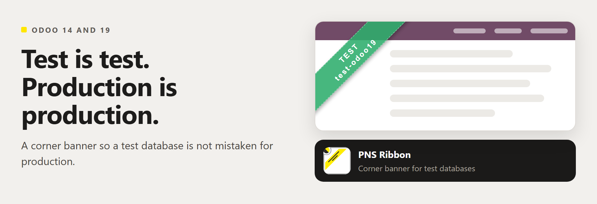
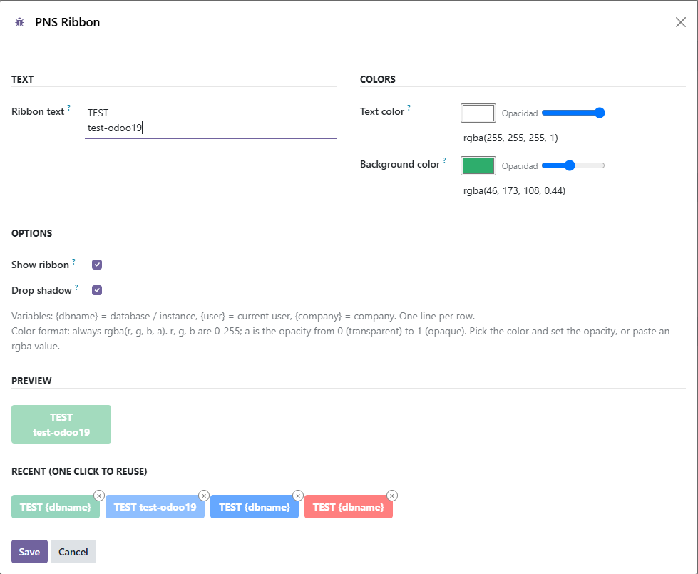

# PNS Ribbon



One tree, every Odoo version we test, the same tests.
`common/` plus `stacks/owl1` (Odoo 14 and 15), `stacks/owl2` (Odoo 16 to 19) and `stacks/owl3` (Odoo 20) ship together. A flat branch (`14.0` … `20.0`) is generated from that tree.

**PATANEGRA Soft** (https://patanegra.com). Part of **Patanegra Soft Suite**.
A diagonal banner on the backend so a test or staging database is not mistaken for production.

<p align="center">
  
</p>

<p align="center">
  
</p>

## What it is

The banner is a plain script and stylesheet injected in the page head.
It does not go through the asset bundler, so an OWL upgrade does not remove it.

Configure it at **Settings → Technical → PNS Ribbon** (administrators).
Text supports `{dbname}`, `{user}` and `{company}`. Colours are `rgba(r, g, b, a)`.
The last 20 colour pairs stay on the wizard. `pns_ribbon.enabled = 0` hides the banner without uninstalling.

On Odoo 14 to 19 it depends only on the Community module `web`.
On Odoo 20 it also needs [`pns_base`](https://github.com/patanegra-soft/pns_base) (Apache-2.0, same flat branch `20.0`): Odoo 20 dropped the access-rights CSV and `get_param`, and `pns_base` brings them back. Put both on the addons path.

## Install

From this tree:

```bash
./install_flat.sh 20.0 /path/to/addons
./install_flat.sh 14.0 /path/to/addons
```

Or clone the flat branch of your series (`14.0` to `20.0`). Update the app list and install Ribbon.

## Odoo versions

| Series | Stack | Status | Branch |
| :--- | :--- | :--- | :--- |
| 14.0 | `owl1` | Tested. Flat branch published. | [`14.0`](https://github.com/patanegra-soft/pns_ribbon/tree/14.0) |
| 15.0 | `owl1` | Tested. Flat branch published. | [`15.0`](https://github.com/patanegra-soft/pns_ribbon/tree/15.0) |
| 16.0 | `owl2` | Tested. Flat branch published. | [`16.0`](https://github.com/patanegra-soft/pns_ribbon/tree/16.0) |
| 17.0 | `owl2` | Tested. Flat branch published. | [`17.0`](https://github.com/patanegra-soft/pns_ribbon/tree/17.0) |
| 18.0 | `owl2` | Tested. Flat branch published. | [`18.0`](https://github.com/patanegra-soft/pns_ribbon/tree/18.0) |
| 19.0 | `owl2` | Tested. Flat branch published. | [`19.0`](https://github.com/patanegra-soft/pns_ribbon/tree/19.0) |
| 20.0 | `owl3` | Tested. Flat branch published. | [`20.0`](https://github.com/patanegra-soft/pns_ribbon/tree/20.0) |
| 13.0 and older | — | Not supported. | |

Ribbon is in the [module catalog](https://www.patanegra.com/catalog.html) of Patanegra Soft Suite, with the rest of the modules and their versions.

Patanegra Soft Suite starts where its AI can run. Odoo 13 has no OWL, which the AI chat is built on. Odoo 8 to 10 run on Python 2, and Odoo 11 and 12 on Python 3.5; the AI engine needs Python 3.7. The suite keeps three stacks (`owl1` for 14.0 and 15.0, `owl2` for 16.0 to 19.0, `owl3` for 20.0 and later) and none for older series.

## Tests

| Where you are | What runs |
| :--- | :--- |
| `main` (multi-version tree) | `python -m pytest unit_tests`, with no Odoo. Then the Odoo tests, after `./install_flat.sh 19.0 <dir>`. |
| A flat branch (`14.0` … `20.0`) | The Odoo tests in `tests/`. The unit tests live on `main`. |

Odoo tests, in an Odoo of a tested series with the module in `addons_path`:

```bash
odoo-bin -d <db> -i pns_ribbon --test-enable --stop-after-init --test-tags /pns_ribbon
```

## License, marks, training

Apache-2.0. See [LICENSE](LICENSE) and [NOTICE](NOTICE).

PATANEGRA Soft™ and PATANEGRA Soft Suite™ are trademarks of PATANEGRA Soft SL. This license does not grant them.

TDM / AI training is allowed (TDMRep `tdm-reservation = 0`). See NOTICE.

## Security

See [SECURITY.md](SECURITY.md). Bugs, ideas and questions: [CONTRIBUTING.md](CONTRIBUTING.md).
